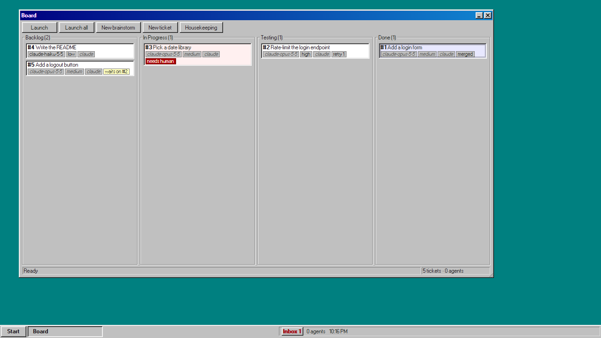

# Kanban95

A Windows 95-styled desktop kanban that runs AI coding agents for you. Write tickets (or talk them through with a planner agent), press **Run**, and walk away. The board takes a few tickets at a time (three by default, set in Settings), smallest first. It starts Claude Code or Codex CLI for each one in its own copy of your repo, has a second agent test the work against the acceptance criteria, retries failures, and merges what passes. It calls you only when it is stuck, with a ding, a red card and an Inbox entry saying what to do.



## Download and install

Get the installer from the [latest Release](https://github.com/dillon-shearer/Kanban95/releases/latest). Pick one file:

- Windows: `Kanban95-<version>-Windows-setup.exe`
- Mac with Apple silicon (M1 and later): `Kanban95-<version>-Mac-AppleSilicon.dmg`
- Mac with Intel: `Kanban95-<version>-Mac-Intel.dmg`

Not sure which Mac you have? Apple menu -> About This Mac shows the chip.

Node comes inside the app. Nothing else is downloaded.

### Windows

1. Run the `setup.exe`. It needs no admin prompt and adds a Start menu entry.
2. The app is not signed, so Windows SmartScreen may warn you. Click **More info**, then **Run anyway**.

The app needs the WebView2 runtime, which Windows 10 and 11 already have.

If the app will not start, the reason is in `%LOCALAPPDATA%\Kanban95\shell.log`.

### Mac

1. Open the `.dmg` and drag Kanban95 to Applications.
2. The app is not signed. The first time, right-click (or Control-click) Kanban95 in Applications and choose **Open**, then **Open** again in the warning. After that it opens normally.
3. On recent macOS versions there may be no Open button. Then go to System Settings -> Privacy & Security and press **Open Anyway** next to the Kanban95 message.

The app reads your login shell's PATH, so it finds the same agent CLIs your Terminal finds.

If the app will not start, the reason is in `~/Library/Logs/Kanban95/shell.log`.

### Updating

The installed app checks GitHub Releases for a new version when it starts. If there is one, it shows a dialog with **Update now** and **Later**. **Later** hides it until the next check.

To check by hand, go to Start -> Settings -> Board -> **Check for updates**.

**Update now** is refused while agents are running. Finish or stop them first.

If the check fails (you are offline, or you have an old version whose check no longer works), download the latest installer from the [latest Release](https://github.com/dillon-shearer/Kanban95/releases/latest) and run it over your existing install. Your settings and board data are kept.

## What you need

- [git](https://git-scm.com/downloads)
- [Claude Code](https://docs.anthropic.com/en/docs/claude-code) and/or [Codex CLI](https://github.com/openai/codex), installed and logged in

That is all. The board holds no API key; the agent CLIs log in themselves. The app carries its own Node but installs none of these. The setup page and Start -> Settings -> Agents -> Requirements show which are found, with an install hint for each missing one.

## First run

1. The setup page asks for a data folder and a project folder. A plain folder is made a local git repo.
2. Open Start -> Settings -> Agents. Pick a CLI, model and effort per phase and press **Save**. Nothing launches until you do.
3. For Claude Code, accept its one-time `--dangerously-skip-permissions` warning by hand. See [docs/CLIS.md](docs/CLIS.md) -> First-run prompts.

[docs/OPERATOR.md](docs/OPERATOR.md) walks through a full cycle from brainstorm to merge.

## Why

Running one coding agent is easy. Running five at once on one repository is not. Kanban95 is the supervisor that makes it work:

- **One worktree per ticket**, so agents never share files, and one merge queue, so merges land one at a time.
- **A tester for every ticket**, a different session from the worker, which must report a pass before the ticket is done.
- **Scoped, revocable grants**: each agent can act only on its own ticket, only through the board's tools, and only while its session lives.
- **Your keys stay yours.** The board holds no provider API key. Everything runs on `127.0.0.1`.
- **Self-cleaning.** Worktrees, branches, session files and grants are removed when a ticket merges, and a janitor sweeps up after crashes.

New to worktrees, MCP or agent tooling? Start with [docs/LEARNING.md](docs/LEARNING.md).

## Documentation

| doc | what it covers |
|---|---|
| [docs/LEARNING.md](docs/LEARNING.md) | a guided tour for newcomers: worktrees, MCP tools, grants, and why the board uses them |
| [docs/OPERATOR.md](docs/OPERATOR.md) | driving the board: brainstorm, operator terminals, launch, the Inbox, settings, voice input |
| [docs/ARCHITECTURE.md](docs/ARCHITECTURE.md) | shell, daemon and UI; REST, events, launch, packaging, repo map |
| [docs/LIFECYCLE.md](docs/LIFECYCLE.md) | the ticket state machine, retries, the merge queue, the janitor |
| [docs/AGENTS.md](docs/AGENTS.md) | what an agent receives, how each role is expected to behave, the skills plugin |
| [docs/MCP.md](docs/MCP.md) | every agent tool, who may call it, its arguments (generated) |
| [docs/CLIS.md](docs/CLIS.md) | how Claude Code and Codex are started: flags, first-run prompts, reach by role |
| [docs/SECURITY.md](docs/SECURITY.md) | grants, audit, the shell secret, the webview, the threat model |
| [docs/DATA.md](docs/DATA.md) | the per-repo SQLite schema, migrations, and every file the board writes |
| [CLAUDE.md](CLAUDE.md) | conventions for agents working on this repo |

## Developing Kanban95

You need these only to work on Kanban95 itself:

- [Node 24+](https://nodejs.org/) on PATH
- [Rust](https://rustup.rs/) (on Windows with the MSVC build tools: Visual Studio 2022 Build Tools, "Desktop development with C++")
- git, and Claude Code and/or Codex CLI logged in

```
git clone https://github.com/dillon-shearer/Kanban95.git
cd Kanban95
npm install
npm run dev -- <project>
```

`npm run dev` builds the daemon and runs the shell on `<project>`, a folder path (default: the cwd). A plain folder is made a local git repo.

Other commands:

```
npm run build        # compiles daemon/ to daemon/dist
npm test             # tsc, then every daemon and UI test: the tester's one full run per ticket; a small set of UI tests drives headless Edge or Chrome (or KANBAN95_BROWSER); at most 5 minutes
npm run test:changed -- main   # only the tests the changes against main (committed or not) can affect, no tsc: what the worker runs
npm run test:shell   # the Tauri shell's tests (cargo test)
npm run docs:mcp     # regenerate docs/MCP.md from the MCP tool table; a test fails if it drifts
```

`npm run dev` and a dev shell start the daemon with the `node` on PATH, which must be Node 24. The installed app uses its bundled Node instead.

The daemon alone: set `KANBAN95_SECRET` to a random string of 32+ characters, run `node daemon/dist/server.js [repo]`, and open `http://127.0.0.1:<port>/?k95=<secret>` with the port it prints ([docs/SECURITY.md](docs/SECURITY.md) -> Shell secret). It exits when its stdin closes, so run it from a parent that holds the pipe.

### Building the installer

`npm run installer` (Node 24 and Rust required; it runs `npm ci` itself) builds a per-user NSIS installer at `shell/target/release/bundle/nsis/Kanban95_<version>_x64-setup.exe`. On macOS it builds `Kanban95.app` and a `.dmg` instead. Building downloads the official Node 24 binary from nodejs.org and checks its SHA-256. `Kanban95.exe` opens the board on the folder passed as its argument, else on its working directory. Details: [docs/ARCHITECTURE.md](docs/ARCHITECTURE.md) -> Packaging.

Each Release is built from a version tag (`vX.Y.Z`). [docs/ARCHITECTURE.md](docs/ARCHITECTURE.md) -> Packaging -> Releases covers tagging, versioning and update signing.

### CI builds

To get a build without building it yourself: open the repo on GitHub -> Actions -> the `build` workflow. Pick a green run on `main` (or your branch) and download the `kanban95-windows` artifact (the NSIS `setup.exe`) or `kanban95-macos` (the `.app` and `.dmg` for Apple silicon and Intel). GitHub serves artifacts as a zip and keeps them 90 days.

On a Mac use the `.dmg` from that zip. The zip does not keep the `.app`'s file permissions, so the bare `.app` will not start.

### Layout

- `daemon/` the TypeScript daemon (HTTP, SQLite, REST, MCP, grants, prompts, worktrees, agent ptys, lifecycle, merge queue, janitor)
- `ui/` the static Win95 UI, no build step, with 98.css, xterm.js and transformers.js vendored
- `shell/` the Tauri 2 shell
- `templates/` the default agent prompts
- `skills/` a Claude Code plugin with the agent skills
- `docs/` the documentation above
