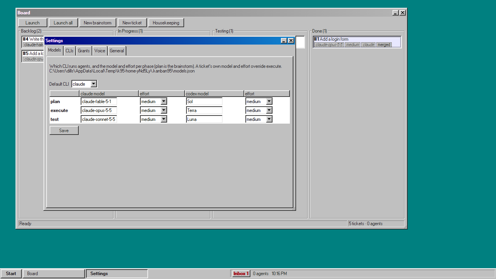
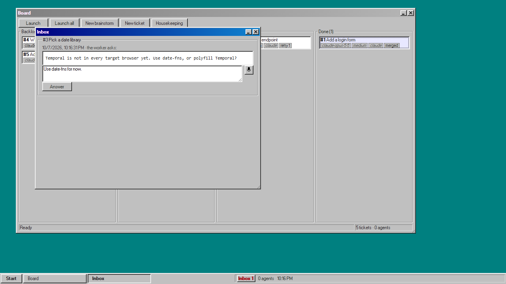
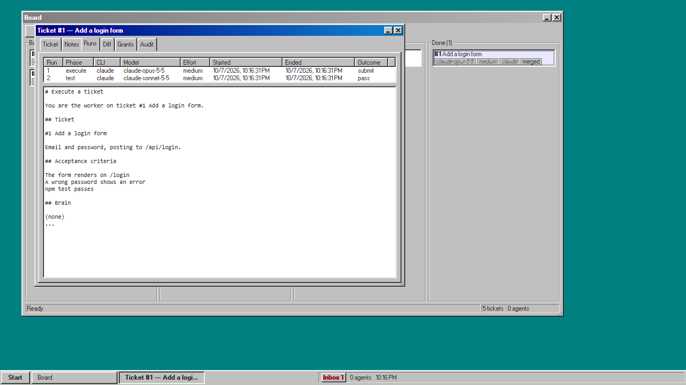
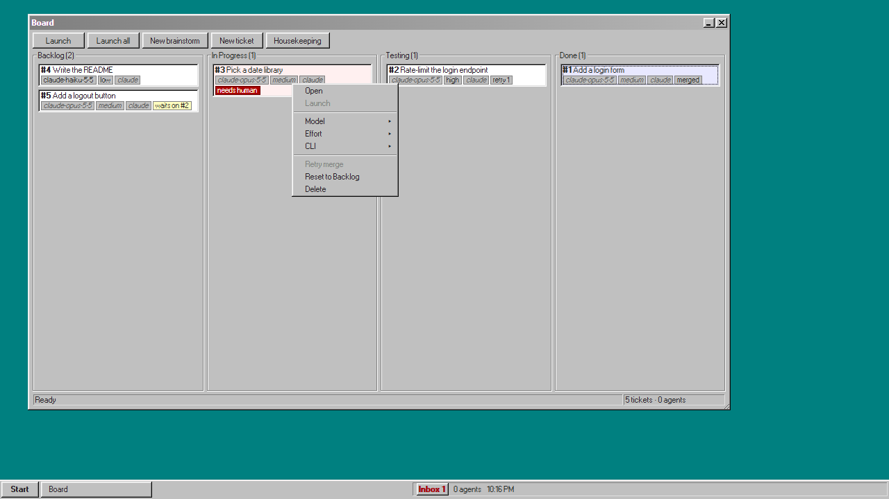
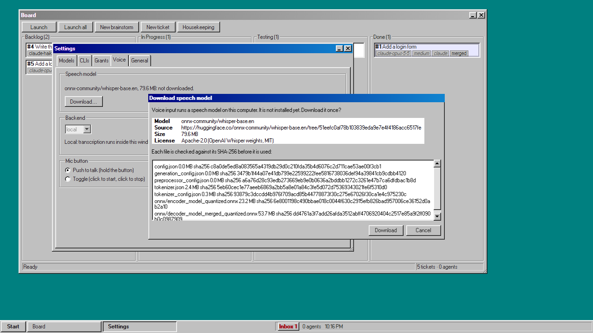

# Operating the board

Living document. How a person drives Kanban95, from an idea to merged work. Update it in the same change that moves a button.

## Before the first launch

### First run

The installed app started from the Start menu or the Dock has no project to open. When no project is listed yet it opens on **Kanban95 Setup**:
- **Data folder**: where the board keeps settings, `models.json`, preferences, `projects.json` and the global brain. Defaults to `~/.kanban95`; type another full path (an SSD you carry between machines, say), or press **...** at the end of the box to pick the folder in a native dialog. Any other folder is recorded in `~/.kanban95/home` before anything is written there.
- **Project folder**: the folder the first board works on. It must exist; a plain folder becomes a git repo on first start. Type it or pick it with **...**.

Under the two folders, **Requirements** lists git, Claude Code and Codex, each "found (version)" or "missing" with a one-line install hint and link (links open in the system browser). The board needs git and at least one of the two CLIs; it installs none of them, and logging in to each CLI stays your step. **Check again** asks once more after you install one. Each tool is asked for `--version` with a 4 s timeout: git on PATH, the CLIs from **Settings → Agents → Executables** when set, else PATH. A configured path that does not exist, or a tool that hangs, shows as missing. The same list sits at the bottom of **Settings → Agents**.

**Next** adds the project to the list and starts its board, whatever the list shows. A folder that does not exist is refused with a message on the page. Later starts without a project open the board last shown in the docked window, or the one picked in **Settings → Projects → Start here** (first project in the list when neither is there); there is no setup again. Ticket worktrees stay on this machine in `~/.kanban95/worktrees/` wherever the data folder is.

If the data folder named in `~/.kanban95/home` is not there when a board starts (an SSD left in another machine, say), no board starts and nothing is created in its place. The window shows the same page with "Data folder <path> was not found. Connect it or choose another folder.", the home folder (`~/.kanban95`, as on first run) in **Data folder** and no project box. **Retry** checks again and, if the folder is back, starts the board (the project you opened, or the first in its list). **Next** with another full path points the board at that folder instead and starts on the first project listed there; a folder with no project listed gets the first-run page. That folder must exist, except the home folder, which is created if needed: Next with the missing path, or any other folder that is not there, says "Data folder <path> was not found" and creates nothing, so a drive that comes back later is not shadowed by an empty copy. Anywhere else, the board also refuses a data folder on a drive that is not connected.

To change the data folder later, use **Settings → Board → Data folder** (Settings below). It only repoints the board: to take your settings and projects along, copy the folder's contents to the new folder by hand first.

1. Log in to Claude Code and/or Codex CLI with their own commands. The board never asks for a key.
2. For Claude Code, accept its one-time `--dangerously-skip-permissions` warning by hand once (`docs/CLIS.md`).
3. Start the board: open the installed Kanban95, or from a source checkout run `npm run dev -- <project>` with the project folder you want it to work on (Node 24 on PATH and Rust; `README.md` → Quickstart). Open **Start → Settings → Agents**, pick the default CLI and a model and effort for each phase (type a model id, or press ▾ beside the box for every model that CLI knows) (plan is the brainstorm, execute does the work, test checks it), and press **Save**. That writes `~/.kanban95/models.json`; until it exists nothing can launch, and the Board's status bar says so.

### Readiness

A board can be set up and still not able to run a ticket. `GET /api/ready` checks, in order: git is found (`git`), `git config user.name` and `user.email` resolve in the repo (`identity`), the base branch has a commit (`commit`), the base has no uncommitted changes to tracked files (`clean`), `models.json` (this project's copy or the global one) names a CLI for execute and test (`models`), that CLI is found (`cli`), Claude Code trusts the repo's worktrees root (`trust`; the board writes it on the first Claude launch, and Codex needs none), and Run is on (`runner`). Each failing item carries a one-line fix. When the board is not ready and has a Backlog ticket, the Board's status bar shows "Not ready: <fix of the first failing item>" on load; click it to open the **Readiness** window, which lists every item with its state and fix and has **Check again**. A brainstorm or operator terminal gets the same list in its brief, and on a board with no done tickets it reports what is not ready before anything else.

### Set up a new board

A board with no tickets shows a small panel, "This board is empty", in the Board window with a **Set up this board** button; New brainstorm stays in the Start menu for planning your own work. The button creates the starter tickets from `<repo>/.kanban95/templates/bootstrap.md` in Backlog, in file order, each depending on the one before and tagged `setup`: write the board's intention into the project preferences, record the build and test commands, choose local-only or push, and confirm readiness with a smoke ticket. No model is called. The panel goes once any ticket exists. It runs once per board: with a `setup` ticket already on the board it is refused. An agent told to set up a board does the same with the `bootstrap_board` tool (planner and operator grants).

`bootstrap.md` is copied from `templates/` on daemon start and kept in step like the prompt templates; edit the repo copy to change the set. Each `## <title>` starts a ticket, the text under it is the body, and the lines after a `Criteria:` line are its acceptance criteria, one per line. Text before the first title is ignored, and a file with no titles is refused.

### Starting a new board

First pick how the board will publish. A plain folder with no remote: merges land locally and nothing is pushed. A GitHub clone without push: leave the branch's upstream unset, or untick Push after merge in Settings -> Board -> Git. A GitHub clone with push: run `git push -u origin <branch>` once.

Then add the project in Settings -> Projects or Start -> Projects and open its board. Open the Readiness window ([Readiness](#readiness)) and fix every item. Press Set up this board ([Set up a new board](#set-up-a-new-board)) and work the setup tickets. After that, use a brainstorm or the operator terminal for real work.

Agents on a new board start at reach level 0. Unlock more per ticket with Approve in the Inbox or in the Ticket window. An agent asked to create a board adds the project with `PUT /api/projects` (or asks you to), calls `bootstrap_board`, and stops.

Common snags: a repo on exFAT (the board trusts it; run git by hand with `GIT_CONFIG_*` set), a repo with no git identity (set `user.name` and `user.email`), a repo under OneDrive (move it out), and a stale `models.json` (Readiness flags it).

### When the app will not start

The error box ends with "Details:" and the path of the shell log: `%LOCALAPPDATA%\Kanban95\shell.log` on Windows, `~/Library/Logs/Kanban95/shell.log` on macOS. It holds one timestamped line per failure that stopped a board or an update (Node.js missing, a daemon that did not start or kept stopping, a window that would not open, a failed update) and nothing else. Read the last lines, or send them along with a bug report; they hold no keys or secrets.

On macOS, if the message says a project or data folder "is on a drive mounted read-only", the drive is most likely NTFS: macOS mounts NTFS read-only and the board cannot write its database there. Reformat the drive as exFAT, which works on both Windows and macOS.

## A full cycle

### 1. Brainstorm

**New brainstorm** (or Ctrl+N) opens a terminal with a planner agent in the repo root. Tell it what you want. It reads the code and the brain, proposes tickets, and writes them to the board with `create_ticket` once you agree. The planner does not change the repo; ask it for a file (a prompt, a note) and it writes it where you say, outside the repo (Claude Code only; a Codex planner is read-only). Cards appear in Backlog as it creates them.

### Operator terminal

For board work that is not a ticket: maintenance on the repo, a refactor you want to steer live, a one-off investigation, fixing the board itself. **Start → New operator terminal** (or Ctrl+Shift+N) asks for a **Mission** (the mic works there too) and opens a terminal titled `Operator — <model>` in the repo root with an agent whose brief starts from your mission, word for word. An empty mission is refused.

On the board it has your reach: it can read and list every ticket, create and edit tickets, add notes, change a ticket's model, and move tickets through the usual steps (launch, submit, fail; it cannot pass a ticket, only a tester can). Outside the board it is not sandboxed. It runs as your Windows account with the same CLI flags as a ticket worker (permissions and approvals off, no sandbox), so it can read and write any file your account can, run any command and use the network. Staying in the repo is an instruction in its brief, not a limit the board enforces. It works in its own worktree beside the tickets' (`<board home>/worktrees/<repo key>/op-<time>`, outside the repo) when it changes code, merges that itself when the tests pass, and ends with a short summary in its terminal. It does not create tickets unless your mission asks it to.

It runs with the **operator** row of Settings → Agents → Models (blank: the CLI's own default model, launched with no `--model`), unless `.kanban95/config.json` has `"operator": { "model": "...", "effort": "..." }` (either or both). It shows in the agent count and the taskbar like a brainstorm. **X** on its window asks "End this operator terminal? Minimize to keep it running."; **End** stops the agent and revokes its grant, Cancel or Esc keeps it running. **Minimize** keeps it running. **Revoke** in Settings → Grants, or closing the board, also stops it.

### 2. Run

**Run** (or Ctrl+L, or Start → Run) works the backlog for you, up to three tickets at a time, lowest ticket id first: it launches tickets, and as each one executes, passes its test and merges, launches the next, until nothing launchable is left. Change how many run at once in Settings → Agents → Runner, "Tickets running at once (this project)" (1 to 10), and Save; it applies at once. The button then reads **Stop**, and the status bar shows `Running: #a, #b (2 of 3; n of m candidates left)`: the tickets it is on against the limit, how many backlog tickets it can launch now, out of everything in Backlog. It keeps tickets that name the same code files apart: one that shares a file with a running ticket waits, and the status bar adds `#id waits: shares files with #n`; when every ticket left shares a file, it starts the first anyway. Smallest means lowest effort first (low, medium, high, max; no effort counts as medium), then fewest acceptance-criteria lines, then lowest id.

It skips what needs you: a red (needs human) ticket waits in the Inbox, and so does anything depending on it, while the runner moves on. When nothing is running and nothing is left it turns itself off with a ding and the status bar says "Runner stopped: nothing left to launch". **Stop** (or Ctrl+L again) starts nothing new; agents already running finish their step and merge. Stop also clears every wait on a dependency (below), so nothing you staged starts later by itself; the status bar says "Runner stopped, n holds cleared." While it is off the board starts no agent by itself at all: a ticket waiting on a dependency stays in Backlog when that dependency merges, the scheduled housekeeping ticket is filed but not launched, and a merge conflict sent back to its worker waits In Progress with no agent. All of them start when you press **Run**. It stays on across a restart.

To start tickets yourself, select them and press **Launch**, runner on or off. A ticket whose dependencies have not merged waits with a yellow "waits on #n" badge and starts by itself when they land, if the runner is on. While any ticket waits like this the status bar says `n held` (hover it for `n waiting to launch by themselves`). **Stop** clears every wait at once; **Cancel wait** in a card's menu clears one. Either way the ticket stays in Backlog with its retry count and notes, and starts only when you launch it or the runner picks it up.

Each card shows its id, title, model, effort and CLI (grey italic means "the phase default from Settings"), then its tags (light blue; set them in the ticket window's **Tags** field, comma or space separated, lowercase letters, digits and `-`), and badges for what needs attention: the agent's phase and how long it has run, e.g. **execute 4m** or **test 1h12m** (an agent is working on it; updated every minute, so a long test run that shows a growing time is not stuck), **needs human** (red), **retry n**, **L1** to **L4** (the ticket's agent level, below), **merged**, **housekeeping** (a ticket the board filed to clean up).

### 3. Watch, or don't

Every agent gets its own terminal window titled `#id — phase — model`. The board opens them by itself, behind whatever you are working in, tiled into a grid left of the Board, Inbox and Notepad that always fits the terminals on screen (see Terminal slots below), for the phases ticked in **Settings → Board → Open a terminal automatically for** (plan, execute, test; all three by default). Brainstorms and operator terminals always open. A session without a window still runs and reports as usual; to watch one, right-click its card → **Terminal** → `phase · model` (one entry per live session of the ticket), or Ticket → Runs → **Terminal**. A session that did not open never pops up later, also after you tick its phase. The setting is `terminals.auto` in `~/.kanban95/settings.json` and applies to the next session that starts; a terminal whose agent finished its step, or that the board ended to start a new one (a merge conflict on submit, a Restart), closes itself a moment later (its output stays in the ticket's Runs tab). If a card says *running* but the terminal in front says "(ended)", the ended one is an older run: the live one is behind it, in the taskbar, or under Ticket → Runs. You can type into any terminal; it is the agent's real session. **Minimize** hides a terminal and keeps its agent running (reopen it from the taskbar or Ticket → Runs). **X** stops the agent for good: it asks first ("End the agent for #id? The ticket is flagged so you can resume it. Minimize to keep it running."; for a brainstorm, "End this brainstorm?"; for an operator terminal, "End this operator terminal?"), and Cancel or Esc keeps everything running. A terminal whose ticket starts needing you comes to the front, also out of minimized, without taking the keyboard from what you are typing in. An ended ticket agent turns the card red with the note "ended by the operator from the terminal window" and offers **Resume** in the Inbox and the card menu. A terminal titled "(ended)" has no agent left, so its X just closes the window.

The ticket moves on its own: In Progress → Testing → Done. A failed test sends it back to In Progress with the tester's notes, up to three retries. When it merges you hear the **ding**.

### 4. When the board needs you

The board fixes what it can before it asks you. When a worker submits, the board first merges the base branch into the ticket's worktree (a merge commit "Merge main into ticket/12" on the ticket's branch, authored as you), so the tester tests the combined code; it does the same again in the merge queue just before landing, so the merge into your main checkout never conflicts and never leaves it mid-merge. If that merge conflicts, or the worktree has uncommitted changes, the ticket goes back to the worker: it stays or returns to In Progress (retry + 1) with a failure note "merge conflict with main: …" (or "worktree has uncommitted changes"), and the agent merges the base in its worktree, resolves the conflict, and submits again. A merge refused only because the main checkout has uncommitted changes is not flagged: the board retries it every 30 seconds and it lands once you commit or stash. So never leave edits in the main checkout while the board runs; work in a worktree.

You hear the **chord** and a card turns red when an agent asks a question, exits without reporting, goes silent (its transcript gains no line for 20 minutes), hits the retry cap, its merge still conflicts at the retry cap, the main checkout is still dirty after 10 minutes, or its merge landed but could not be pushed. Every one of these lands in the **Inbox** (the "Inbox n" button in the taskbar tray at the far right, by the clock; n counts them all), and the ticket's facts line says "needs human (the Inbox says why)". A question has an answer box: type the answer and press **Answer**; it is typed into the agent's terminal and the card's badge clears. A ticket has one entry: a newer question replaces an older one. Answering in the agent's terminal counts too: Enter there clears the badge and closes the entry, and until then the worker cannot move its ticket to Testing. If the agent that asked is gone (it exited, or the board restarted), your answer is kept on the ticket and the agent for its phase starts again; a ticket in Testing gets its tester. A question that starts "Claude Code is waiting on its own prompt" is Claude Code's own yes/no menu (a safety check it asks even with permissions off; it denies by itself after about two minutes): answer with the option's number or label, `1` or `Yes` to let the command run, `2` or `No` to refuse, and the board picks that option in the terminal. If Claude Code denies it first, the item leaves the Inbox once the agent writes again. A permission request (an agent's `request_permission`, after a call was refused for its ticket's Agent level) shows the level or Read all tickets it asks for and its reason, with **Approve** and **Deny** instead of the answer box. **Approve** sets the ticket's Agent level and Read all tickets as asked (the same save as in the Ticket window) and types "approved: level N, read all; retry the refused call now" into the agent's terminal; the agent's next call runs at the new level. **Deny** types "denied" and changes nothing. Either clears the badge. The same request, with the same Approve and Deny, also shows at the top of the ticket window's Ticket tab. A request the Inbox no longer shows (the agent that asked exited, or you resumed, restarted or launched the ticket since) is dropped: it no longer blocks the agent, which asks again if it still needs the level. You can also answer in the agent's terminal: a line starting `yes`, `ok`, `approve` or `allow` approves (level and Read all set as asked), `no` or `deny` denies, and any other line closes the request without granting anything. Every answer you send ends with the ticket's level in brackets, such as `[agent level 0, unchanged]`, so you and the agent can see whether it changed. An agent cannot ask for a level with an ordinary question (that question is refused and the agent is pointed at the permission request), so to change a level, use Approve or the Ticket window. Anything else shows the note that flagged it: what happened, then a line starting **To resolve:** with your next step (for a merge conflict it names the worktree's full path, e.g. `C:\Users\you\.kanban95\worktrees\my-project-1a2b3c4d\t-12`, and the button: **Resume** if the ticket is In Progress, **Retry merge** if it is Done; otherwise the button). **Retry merge** re-runs the whole queue job, including the merge of the base into the worktree, so a fix you committed there is checked against the latest base. Its buttons are **Operator fix** (starts an operator terminal whose mission is the ticket and this note, to find and fix the cause; it then says whether to Resume, Restart or Reset), **Retry merge** (a done ticket that has not merged), **Resume** and **Restart** (a running ticket) and **Reset to Backlog** (any ticket not done). The Board's status bar also says why at the moment a card turns red (`#n needs you: …`). A launch the board refuses outright (no models saved, uncommitted changes on the base branch) starts no agent and opens no terminal (the card moves to In Progress and turns red with `launch failed: …`), so that line and the Inbox are where its reason shows. For an agent that went away (it crashed, its launch failed, it exited without reporting), press **Resume**: the agent for the ticket's phase starts again in the same worktree with the retry count kept. A Claude Code agent picks up its own conversation where it stopped (when Claude Code still has it); a Codex agent, or one whose conversation is gone, starts fresh with the failure note in its brief. Resume is also in the card menu, and **Launch** on such a card does the same. Launch on a card whose agent is still running is refused: open its terminal, or Reset to Backlog to stop it. For an agent that is still running but stuck (idle, hung, waiting on nothing), press **Restart** (card menu, ticket window, Inbox, or Ctrl+R in a ticket window) and confirm: the running agent is ended and a new one starts in the same phase and worktree, retry count kept, told to read `git status` and `git log` and carry on. Reset to Backlog, by contrast, starts the ticket over.

An agent can also stop without exiting: an API call that never returns, or a CLI sitting at its prompt after an error (a model it does not know). Its spinner may still turn, so the board goes by its transcript: when a running agent's Claude Code transcript (or Codex rollout) has gained no line for **Settings → Agents → Silent agents** minutes (`idle_minutes` in `~/.kanban95/settings.json`, default 20), the card turns red with the chord and the note "agent silent for N min", followed by the last lines of its terminal. The agent keeps running: open its terminal (card menu → **Terminal**), fix what it is waiting on there, or press **Restart** if it is hung. If it starts writing again on its own, the flag clears by itself. Keep the setting above 10 minutes, the longest a single command an agent runs may take, so a long test run is not flagged.

When the board restarts, every agent it was running is killed. Tickets that were running and not flagged are resumed by themselves, once, a Claude Code agent in its own conversation; you only hear the chord if a resumed agent then exits without reporting. A ticket that was already red before the restart stays red until you resume it.

**Start → Restart board** picks up daemon and UI changes (after a merge into `daemon/` or `ui/`, say) without closing the window. The confirm says how many agents are running (they are resumed after the restart, as above) and how many brainstorm or operator terminals will close. On **Restart** the board runs `npm run build` in the Kanban95 checkout, the status bar says "Restarting…", the daemon starts again on a new port and the window reloads there. If the build fails, nothing restarts: a dialog shows the compiler output and the board keeps running. An installed board has nothing to build and just restarts. It does not pick up changes to `shell/` (those need `cargo build` and closing and starting Kanban95 again), nor a new `npm install`.

**Restart after a merge: "restart pending, N tickets to finish".** A merge only changes files on disk: the UI is served from disk and updates at once, but the daemon keeps running the code it started with and the templates it copied at start. So after a merge that changed `daemon/`, `templates/`, `package.json` or `package-lock.json`, the board stops starting new tickets from Backlog. Tickets already in progress or testing finish as usual (worker, tester, retries, merge). The Board's status bar shows "restart pending, N tickets to finish" and the taskbar tray shows a red **Restart** badge next to the Inbox count. Open brainstorm and operator terminals hold it too, since a restart would end them: the line adds ", M terminals to close". When both reach 0 the board restarts itself, the same as Start → Restart board, and the runner carries on with the backlog (if it was off, it stays off). You can still restart sooner with the badge (or Start → Restart board), and your own Launch on a card is never held. A merge that changed only `shell/` holds nothing: the runner carries on and the **Restart** badge stays up until you close Kanban95 and start it again (the confirm says so too). The board cannot restart itself in two cases, and the status bar says what to do: the build failed ("Start → Restart board shows why"; the next merge tries again), or the daemon was started by hand without the shell ("then Start → Restart board"). Everything goes back to normal once the daemon starts on the merged code. Merges that touch only `ui/` or `docs/` show nothing (`docs/LIFECYCLE.md` → Restart after a merge).

**Start → Release board…** cuts a new Kanban95 release. It shows only on the Kanban95 repo itself, and only after you tick **Show Release board** in **Settings → Board → Updates** (`release` in `settings.json`, off by default; the box shows only on the Kanban95 repo). It applies at once, no restart. The dialog shows the current version and three choices, each with the version it would make: **Patch** (selected), **Minor** and **Major**. On **Release** the board bumps `package.json`, commits "Release vX.Y.Z" as you, tags `vX.Y.Z` and pushes the branch and the tag. The pushed tag starts the release workflow, which builds the installers; the dialog says the tag was pushed and shows the link to https://github.com/dillon-shearer/Kanban95/actions; clicking it opens the page in your default browser and the Kanban95 window stays on the board. Nothing releases unless you press the button. It refuses, and the dialog says why, while a ticket runs or a brainstorm or operator terminal is open, when the main checkout has uncommitted changes, or when the branch has commits not pushed yet (use **Push** first). If the push fails, the release commit and tag are removed again and the dialog shows git's message.

**"release: N commits"** in the Board's status bar (hover it for "release pending (N commits since vA.B.C)") means N commits that change `daemon/`, `shell/` or `templates/` have landed since the last release tag. It shows only while Show Release board is on. It is a reminder only and holds nothing; it clears after the next Release board. Running the installed app, a merge into the Kanban95 repo shows this instead of "restart pending": the installed app runs its own copy of the code, so restarting would not pick the merge up. Restart board on the installed app restarts without a build.

For anything else, open the ticket (double-click the card): the Notes tab has the failure notes (it opens at the latest note), Runs has each run's exact prompt and terminal output, Diff shows what the worktree changed. Text you type in the Ticket tab stays while you look at other tabs and when the ticket changes underneath; it is only kept once you press **Save**. Below the fields, **Agent level** and **Read all tickets** widen what this ticket's worker and tester may do on other tickets, for every run of the ticket, from the next tool call: 0 is its own ticket only; 1 lets it launch and reset any ticket; 2 also move any running ticket to Done without a test (no merge is queued; use Retry merge to land it); 3 also edit, re-model, note and delete empty Backlog tickets; 4 gives it your own operator reach, except proving a ticket. Read all tickets lets it read the whole board. **Targets its agents may read** and **Targets its worker may also edit** name single tickets it may read, or read and rewrite (body and criteria), without depending on them; set them before you launch the ticket. Press **Save** to apply them. An agent cannot change either (`docs/MCP.md` → Levels). Closing a ticket window (Esc, X, the taskbar button's Close alone or in a selection, or the ticket being deleted) with unsaved edits asks "Discard changes?": **Cancel** keeps the window and your text, **Discard** closes it. A New ticket window asks the same.

### 5. Done

A ticket counts as merged only once its work is published: after the merge into your base branch, the board runs `git push` of that branch to its upstream (say `origin/main`) from the main checkout, which also sends any earlier commits you had not pushed. Git signs in with your own credential helper or SSH key, as when you push by hand; the board never sees them. If the push fails (the remote has commits you lack, you are offline or signed out), the merge stays in your branch, the ticket stays in Done with a red card and the chord, and its note quotes git's message. Fix it in the main checkout (pull and merge, reconnect or sign in), then **Retry merge**: it only pushes again. A branch with no upstream is never pushed, so a local-only repo (a plain folder the board made a repo, Projects below) works as before: merges land locally and the Push button and unpushed count stay hidden until you add a remote and set the upstream (`git push -u origin <branch>` once). Untick **Settings → Board → Git → Push the base branch to its upstream after each merge** (`push_after_merge` in `~/.kanban95/settings.json`) to stop pushing.

When the board starts with commits on the base branch its upstream lacks (a crash, or a time pushing was off), the Board's status bar shows **N not pushed** (hover it for "N commits not pushed") with a **Push** button that pushes them; a refusal shows git's message in the status bar.

**Deliverables.** Merges and file changes add nothing to the Inbox by themselves. When you ask for it, a worker or an operator terminal posts a folder or a file with the `post_deliverable` MCP tool: an absolute path, in the repo or outside it (for example a data root like `<data root>/<topic>/<deliverable>/<version>/`). The entry shows the full path, the ticket and the time it was posted, with **Open folder** (Explorer on Windows, Finder on macOS; for a file, the folder holding it) and **Dismiss**. A second post of the same path replaces its entry. These entries count in "Inbox n" but do not turn it red.

A merged ticket's worktree and branch are removed by the board. Every ten merged tickets the board files a housekeeping ticket in Backlog; the **Housekeeping** button files and launches one on demand. Settings → Agents → Housekeeping switches the automatic ticket off or changes the interval.

If you review a Done ticket and it is not right, **Reject** it (card menu, or the button in its ticket window; only on Done tickets). The dialog has one box, "What is wrong and what done looks like", and will not submit empty. The ticket goes back to In Progress with its retry count at 0 and a worker starts at once, with your text in its brief under "What failed on the last attempt". If the ticket had not merged yet, its merge is cancelled and the worker continues in the same worktree; if it had, the worker gets a fresh worktree from the base branch, which already holds the merged work, and the next pass merges again. Reset to Backlog, by contrast, starts over and loses your reason.

## The windows

| Window | Open from | What it is for |
|---|---|---|
| Board | Start → Board | the four columns, the toolbar (Launch, Run/Stop, New brainstorm, Housekeeping, the Filter box), the status bar |
| Ticket | double-click a card, **New ticket** | fields and attachments, notes timeline, runs and prompts, diff, live grants (Revoke), audit trail. Ctrl+V a screenshot (outside a text field) or drop a file on the window to attach it; the agents get its path. Images show a thumbnail and open in their own window, other files download, **Remove** deletes one. The form's **Depends on** field lists the tickets it waits for, the two **Targets** fields the tickets its agents may read or edit without waiting; a new ticket takes attachments once it is created |
| Terminal | opens by itself; Ticket → Runs → Terminal | one agent session, keyboard and mic |
| Inbox | taskbar "Inbox n", Start → Inbox | every ticket that needs you: questions to answer, and failures with what resolves them; and the folders and files agents posted with `post_deliverable` |
| Brain | Start → Brain | search what agents learned (no query lists the newest), add a note yourself. Each row shows when it was written and from which ticket, with that ticket's status, so a row written for work that never landed stands out. **Edit** changes a row in place, **Delete** removes it after a confirm; merge rows by editing the survivor and deleting the rest. Agents name rows to delete in their summary notes, since only you and the planner can delete |
| Settings | Start → Settings | what it holds, listed under the table |
| Notepad | Start → Notepad | your own scratch notes for this repo, saved as you type |
| Limits | Start → Limits, taskbar limit | the usage limits (see Limits below) in a small window to keep open beside the board |

What the Settings window holds, one subject per tab:

- **Agents**: the default CLI, model and effort per phase, CLI paths, trusted folders (**Clear Claude trust**), runner concurrency (Tickets running at once, `concurrency` in `settings.json`, default 3), Workers read (own ticket and dependencies, the default, or all tickets: `workers_read` in `settings.json`), silent agents, housekeeping
- **Prompts**: preferences, templates
- **Board**: zoom, sounds, which phases open a terminal by themselves, push after merge, voice (speech model, mic button mode)
- **Projects**: the repos this board knows
- **Grants**: every live agent grant

The desktop has an icon for Board, Inbox, Brain, Settings, Notepad, Limits, New ticket and New brainstorm down its left edge: click selects, double-click or Enter does what the Start menu entry does. Icons sit under every window.

Windows can be dragged by the title bar, resized from the corner, minimized to the taskbar and maximized to fill the desktop (Maximize button or double-click the title bar; Restore puts it back). Board, Brain, Inbox, Settings and Notepad remember where you left them, maximized or not, also after the board restarts (it is kept per repo in `.kanban95/ui.json`). A window with no remembered place (a Ticket window, say) opens where it covers the least of the windows already open, minimized ones aside: in free space while the desktop has room, and on a full desktop at the spot least covered, always inside the desktop. When the desktop changes size (you resize the board's window, or go full screen with F11) every window keeps its share of it: the Board, Inbox and Notepad grow or shrink with the screen instead of leaving empty desktop beside or below them, and a remembered place is kept relative to the screen it was saved on.

**Terminal slots.** Terminals tile themselves, like Windows snap layouts, so every live agent is in view without dragging. Their region is the desktop between the desktop icons and the action column: from just right of the icon column (so the icons always show and stay clickable) to the left edge of whichever of Board, Inbox and Notepad is furthest left (open and not minimized or maximized), the full height; with none of the three open, the rest of the desktop. The grid always fits the terminals you can see, with no holes: three show as one row of three, five as five. The shown terminals (not minimized, not maximized, not dragged out) fill the slots in reading order, in the order they last had, a new one last. The grid is sized for how many there are:

| Terminals | Grid (columns × rows) |
|---|---|
| 1 | 1 × 1 |
| 2 | 2 × 1 |
| 3 | 3 × 1 |
| 4 | 2 × 2 |
| 5–6 | 3 × 2 |
| 7–9 | 3 × 3 |
| 10–12 | 4 × 3 |

Every time a terminal opens, closes, ends and is closed, is minimized or restored, is maximized or restored, is dragged out or rejoins, the grid repacks to fit: close one of four and the other three become a row of three; open a fifth and the five fill 3 × 2. A minimized or maximized terminal leaves the grid; restore puts it back where it was, and the others make room. The grid follows Board, Inbox and Notepad when they open, close, move or are resized (so moving the Board left narrows the region), and the desktop when it changes size. An ended terminal stays in the grid until you close it so you can read it; **Start → Close ended terminals** closes all of them at once. Drag a terminal by its title bar or resize it from its corner and it is free: it stays where you left it and the others repack to fill the region. Nothing else takes a terminal out of the grid: a click or a text selection inside it, or the grid repacking while you hold the mouse button, leaves it in place. Double-click a free terminal's title bar to put it back in the grid, last, and the grid repacks to fit (on a terminal in the grid, double-click maximizes, as on any window). To arrange terminals yourself, untick **Settings → Board → Terminal tiling → Tile terminals into slots left of the Board** (`terminals.tile` in `~/.kanban95/settings.json`, on by default): new terminals then open where they cover the least, every terminal stays where you drag it, and double-click maximizes. Tick it again and every terminal, free ones too, joins the grid at once. Past 12, a new terminal opens where it covers the least and stays there until one of the 12 leaves the grid. To change the arrangement edit `SLOTS` in `ui/wm.js` (and `ACTION` beside it for which windows make up the action column).

The taskbar works like a modern Windows one in Win95 clothes. After **Start** comes the Switch board button, then the pinned icons, the same entries as the desktop icons (Board, Inbox, Brain, Settings, Notepad, Limits, New ticket, New brainstorm): one click opens one. Then each open window has a button with an icon showing what it is and a short label: Board, Inbox, Brain, Settings, Notepad, Limits, the ticket window's title ("Ticket #12 — …", or "New ticket"), and for terminals the ticket and phase ("#74 execute", "#74 test", "#74 plan"), "Brainstorm" or "Operator", with "(ended)" once its agent is gone. The buttons are narrow (80px) with small text so many windows fit; a label too long for the button ends in "…", hover it for the window's full title. The tray at the right (Inbox n, Restart, Claude n%, N agents, the clock) uses the same small text. With more windows than fit, small arrows appear at the ends of the taskbar buttons; click them or turn the mouse wheel over the taskbar to scroll. Right-click a taskbar button (or focus it and press Shift+F10 or the Menu key) for Restore, Minimize, Maximize and Close, plus **Open ticket** on a ticket's terminal; Close there only closes the window, the agent keeps running. Ctrl+click buttons (Cmd+click on macOS) to select several, Shift+click to select a range; right-click a selected one to Restore, Minimize or Close them all. A plain click clears the selection. Drag a button sideways to reorder the taskbar (the order resets on reload).

**Startup layout.** At start the board opens the windows of its startup layout, each where you last left it, or at the layout's place if you have not moved it: by default the action column: the Board in the top-right corner, the Inbox in the bottom-right corner and the Notepad left of the Inbox at the same height, together half the desktop's width so the left half is for terminals (always clear of the desktop icons, and sized again at every start until you move them). Then the terminals of live sessions tile into the slots left of them. The Done column starts folded until you fold or unfold any column. To change the layout, open the windows you want among Board, Inbox, Notepad, Brain and Settings, drag and size them, and choose **Start → Save startup layout**; the next start opens exactly those windows there (a window you closed first is left out). **Start → Reset startup layout** goes back to the default from the next start, forgetting where those windows were. The layout is kept per repo in `.kanban95/ui.json`. A window opened later in the session, from the Start menu or an icon, still opens where you last left it.

**Terminal colours.** A terminal's title bar shows what its agent is doing, whether or not the window is focused; an unfocused one shows a paler version of the same colour. **Blue**: executing a ticket. **Green**: testing a ticket. **Purple**: a brainstorm or an operator terminal. **Orange**: the ticket needs you (an open question or a failure that stopped it; the Inbox says why), whatever its phase; it goes back to blue or green when the flag clears. **Grey**: the session has ended, whatever the ticket's flags. Every other window keeps the standard blue title bar when focused and grey when not.

## Notepad

A place to draft before you hand words to an agent or a ticket. One plain text area, with the mic beside it. It saves half a second after you stop typing, when you close the window, and before you switch or close the board (an edit under 64 KB is also sent if the window goes away first), to `.kanban95/notepad.md` in the repo (git-ignored; each repo has its own). **New brainstorm from notes** starts a brainstorm whose planner gets the selected text, or the whole page when nothing is selected (the button's tooltip says so), as its starting notes in its brief, so it reads them first and asks only about what your draft leaves open. If the repo's `brainstorm.md` is older than starting notes (it has no `{{mission}}`), a dialog says "brainstorm.md in this repo predates starting notes. Reset it to the shipped default and start the brainstorm?": **Reset and start** puts the shipped default back (as Settings → Prompts → Reset to default does) and starts the brainstorm with the same text; **Cancel** starts nothing and leaves the file as it is. The repo's copy is never replaced without that click. **Copy** puts the same text on the clipboard. Up to 256 KB; past that the status line says it was not saved and the file keeps the last text that fit. Agents never read it.

## Cards

Click a card to select it, Ctrl+click (Cmd+click on macOS) to add or remove one, Shift+click to select the run of cards in the same column from the last one you clicked, Ctrl+A to select every card the filter shows; click empty column space to clear the selection. Right-click a selected card and its menu acts on the whole selection: one confirmation for Reset to Backlog or Delete naming the count, Launch starts only the Backlog cards and says how many it skipped, Open opens at most 8 Ticket windows, and the status bar reports the outcome once ("Effort set to high on 4 tickets."), naming any ticket the daemon refused while the rest go ahead.

The **Filter** box at the right end of the Board's toolbar narrows the Board as you type: a card stays when every word is in its id, title, a tag, its model, CLI or effort (case-insensitive; the model and effort are what the badges show, defaults included). `tag:ui` keeps only cards tagged exactly `ui`; `model:`, `cli:` and `effort:` limit a word to that field; `is:blocked` keeps only Blocked cards. A filtered column's legend reads "Backlog (3 of 12)". Each column sorts on its own: the ▾ after a column's count opens its **Sort** menu (the current one ticked): id (default), updated (newest first), effort (max to low; a card with no effort of its own counts as medium), model, tags (alphabetical, untagged last) or needs-human first; ties go by id. A column not sorted by id names its sort in the legend ("Done (86) · updated"), so Done can show the latest first while Backlog stays in id order. The filter and every column's sort are kept per repo across reloads and restarts. Cards the filter hides drop out of the selection, so a bulk action never reaches them.

Right-click a card for its menu: Open, Launch, Resume (a red running card whose agent is gone), Restart (one In progress or Testing card: replaces its agent), **Model**, **Effort** and **CLI** (set or clear this ticket's override without opening it), Retry merge (after you fixed a conflict or cleaned the main checkout), Reject (one Done card: send it back to a worker with a reason, see Done above), Cancel wait (a Backlog card waiting on a dependency: clears the wait only, retry count and notes kept), Block and Unblock (park the selected cards by hand: nothing runs or merges on a Blocked card until you unblock it, and unblocking starts nothing; the card shows a dark `blocked` badge and the Ticket window has the same button; see `docs/LIFECYCLE.md` → Blocked), Reset to Backlog (also clears a wait, and resets the retry count), Delete.

Drag a card to any column to put it there by hand (docs/LIFECYCLE.md → Moves by hand):

- **Any column → Backlog**: reset. Flags and the retry count are cleared, a running agent is stopped. Launch it again when ready; its worktree and branch are reused.
- **Any other move**: the ticket goes to that column as is. A running agent is stopped (you are asked first), the needs-human flag is cleared, and no agent is started; Launch starts one for the new column.
- **Into Done**: work on an unmerged branch goes to the merge queue. A ticket with no branch is closed as it is.

## Keyboard

| Key | Does |
|---|---|
| Esc | closes the focused window (or an open menu); a ticket window with unsaved edits asks first |
| Ctrl+Tab | switch to the next board hosted in this window (wrapping) |
| Ctrl+Shift+Tab | switch to the previous hosted board |
| Ctrl+1 to Ctrl+9 | switch to the 1st to 9th hosted board |
| Ctrl+L | Run / Stop the runner |
| Ctrl+R | Restart the agent of the focused ticket window (after a confirm) |
| Enter, Space, arrows | on a focused card (Tab to it): Enter opens the ticket, Space selects or deselects it (Shift+Space selects the range), Up/Down move to the card above or below, Left/Right to the next open column |
| Ctrl+A | select every card the filter shows in an open column (on the Board, outside a text field) |
| Ctrl+F | focus the Board's Filter box (Esc in the box clears it) |
| Ctrl+N | New brainstorm |
| Ctrl+Shift+N | New operator terminal |
| Ctrl+Shift+R | Start recording, or stop it and render (the tray's Rec button; only with `recording.enabled`, not inside a terminal) |
| Ctrl+Shift+Space | Switch the recording between regular and fast (the tray's speed button; only while recording, not inside a terminal) |
| Ctrl+= or Ctrl++ | Zoom the whole UI in by 10% (up to 200%) |
| Ctrl+- | Zoom out by 10% (down to 80%) |
| Ctrl+0 | Zoom back to 100% |
| F11 | Full screen on and off (also Start → Full screen): the board takes the whole monitor it is on, over the Windows taskbar. Switching boards keeps it full screen on Windows; on macOS a switch leaves full screen (press F11 again). Works inside a terminal too |

The switch keys (Ctrl+Tab, Ctrl+Shift+Tab, Ctrl+1 to Ctrl+9) go over the boards hosted in this window in Settings → Projects order, act only while it hosts more than one, and work inside a terminal too. Inside a terminal every other key goes to the agent instead: Esc interrupts Claude Code, Ctrl+L clears its screen. The zoom keys do not zoom there: Ctrl+- reaches the agent as Ctrl+_ does in a native terminal, and Ctrl+= and Ctrl+0 do nothing. Click a title bar or the desktop first to zoom.

## Zoom

The zoom scales everything together: windows, cards, menus, dialogs, the taskbar and the terminals' text, so the Win95 layout keeps its proportions. **Settings → Board → Zoom** shows the current level and sets it, 80% to 200% in steps of 10%. It is `zoom` in `~/.kanban95/settings.json` (1 is 100%), so it survives a reload and a restart and applies in every repo, or in this repo alone when it has its own settings.json (Settings below). Remembered window places are kept in unzoomed units; at any zoom a window is kept on the desktop, and one larger than the zoomed-in desktop is shrunk to fit it. A terminal refits to its window, so a larger zoom gives it fewer columns and rows of larger text.

At 100% and 200% the UI text is 98.css's pixel font. That font is drawn for whole pixels, so at any other zoom its strokes were resampled unevenly and showed stray horizontal lines through the text (status bar, buttons, cards). At those zooms the board now draws all UI text in Tahoma: `setZoom` in `ui/wm.js` sets the `k95-vector` class on body, and `ui/app.css` switches the `--k95-font` variable that body and every 98.css control take their font from. Terminals draw their own text and are unaffected.

## Settings

Models (`models.json`), board settings (`settings.json`) and preferences (`preferences.md`) live in `~/.kanban95/` and apply to every project. A project can have its own copy of any of them in `~/.kanban95/projects/<repo key>/`, outside the repo so nothing is committed. A copy starts as a copy of the global file and, while it exists, replaces that file whole for that project's board: keys are never mixed between the two. Delete the copy and the project follows the global file again. Every operator setting follows this rule, runner concurrency included. Left per repo on purpose: Trusted folders (Claude Code's own file), Grants, the Projects list, window layout (`<repo>/.kanban95/ui.json`) and prompt templates.

The top of the Settings window has a switch with two positions, **All projects** and **This project (<folder name>)**. It picks which file the Agents tab (models.json for Models; settings.json for Executables, Runner, Silent agents and Housekeeping), the Board and Recording tabs (settings.json) and the Preferences editor on the Prompts tab edit. Templates, Projects and Grants are not affected. It starts on All projects each time the page loads.

- **All projects** edits the global files in `~/.kanban95/`, as before.
- **This project** with no copy yet shows the global values greyed, the line "Uses the global settings" and a **Customize for this project** button. The button starts this project's copy of that one file and shows it for editing. Each file has its own button, so a project can have its own models and keep the global sounds.
- **This project** with a copy edits the copy; **Save** writes it. **Use the global settings again** asks first, then deletes the copy and goes back to the greyed view.

**Settings → Agents → Executables** has a box per CLI, `claude` and `codex`: blank uses the one on PATH, or type the full path to the executable, or press **...** to pick the file in a native dialog.

**Settings → Recording** edits the `recording` keys of settings.json. **Save** writes every field at once and says "Saved."; the Enable box shows or hides the taskbar's recording buttons at once. Top to bottom:

- **Enable recording** (`recording.enabled`).
- **ffmpeg** (`recording.ffmpeg`): blank uses ffmpeg on PATH, or type the path or press **...**. The line under it says "found: <path> <version>" or "not found" in red.
- **Monitor** (`recording.monitor`): every attached monitor as "<n>: <name> <width>x<height>", the primary marked "(primary)". **Refresh** asks again for ffmpeg and the monitors. A saved monitor that is gone shows the first one selected and a note saying so.
- **Frame rate** (`recording.fps`): 30 or 60.
- **Quality** (`recording.quality`): High (CRF 18), Medium (CRF 23) or Small file (CRF 28).
- **Fast speed** (`recording.speed`): 2 to 60 times.
- **Output folder** (`recording.output`): blank for `<home>\Videos\Kanban95`, or type a folder or press **...**.
- **Keep the raw recording and markers next to the final video** (`recording.keepRaw`).
- **Render again**: pick a recording folder's `raw.mkv` (its `markers.json` must sit beside it), set **Speed** (2 to 60, filled with the saved Fast speed each time the tab opens; changing it does not change the setting) and press **Render**. It writes `<speed>x.mp4` in that folder beside any earlier render; a speed already rendered is overwritten, other files are not. Each render shows in the Inbox as `Recording <folder name> <speed>x`. The raw file is what gets rendered, so leave **Keep the raw recording** on if you may want another speed later. It says why when refused, else "Rendering..." and then "Done: <mp4 path>" or the error.

Under the fields a line repeats the keys: Ctrl+Shift+R starts and stops, Ctrl+Shift+Space switches between regular and fast.

Every **...** button opens the dialog through the Kanban95 app and shows only there, not on a board opened in a plain browser. It is greyed while its dialog is open; Cancel leaves the box as it was, and typing a path by hand works the same either way.

**Settings → Board → Data folder** shows only on All projects, since it is this machine's pointer, not a project setting. It shows the current data folder and a box for a new full path (type it, or press **...** to pick the folder in a native dialog). **Use this folder** asks "Point Kanban95 at <path>? Every board in this window closes and starts again from that folder. Nothing is copied." On OK the board writes the path to `~/.kanban95/home` (or removes that file when the path is `~/.kanban95` itself) and restarts the way Restart board does, without a build. The folder must already exist: a typo is refused with a message naming the path, and nothing is created. It is refused, naming the count, while an agent, brainstorm or operator terminal runs on any board in this window. Nothing is moved, copied or merged. Every board hosted in this window restarts on the new folder: the one you pressed it on as Restart board does, the others as if closed and opened again, each staying where it was shown.

While This project is on, the window title reads "Settings: <folder name>". The runner count on the Agents tab, "Tickets running at once (this project)", shows in both positions: it is always this repo's. The board runs on what resolves for this project: on load the page reads this project's copy when there is one, else the global file, for sounds, zoom, which terminals open and tile, and voice.

## Projects

Each board works on one repo, so with several boards open they are told apart by name and colour. The window title and its taskbar entry read `<repo folder> — Kanban95`, and each project has its own wallpaper colour under the same blueprint grid.

**Start here**, above the list, picks the board the app opens when started from the Start menu or the Dock: **Last opened** (the default, the board last shown in the docked window; a popped-out window does not count) or one listed project. It is saved at once to the global `settings.json` (`startup`), never a project copy. A picked project whose folder is gone falls back to Last opened, then to the first project in the list.

**Settings → Projects** lists every repo a board has run on (`~/.kanban95/projects.json`, shared by all boards; a board adds its own repo the first time it starts, in the default teal). Each row has the folder name, the path, a colour picker and **Remove**. Pick a colour and it is saved at once; for this board's own project the wallpaper repaints straight away and keeps the colour after a reload or restart. To add a project, type its path in **Folder**, or press **...** to pick it in a native dialog, and press **Add**: it must be an existing folder, or the status bar says it "is not a folder" and nothing changes. A plain folder needs no git: it is added as it is. The board's own project, marked "(this board)", cannot be removed. A project whose folder was deleted or moved is marked "(missing)"; while it is listed, other changes here fail with "is not a folder", so remove it first. On macOS a project from the Windows machine (a `D:\...` path) also shows "(missing)", but it does not block other changes and is kept as it is for Windows; Remove it only to forget it there too.

**Where a project's board data lives.** Tickets, notes, attachments and the brain are in `<project>\.kanban95` (`board.db`, gitignored), not in the data folder. **Remove** only forgets the project and says so in its confirm; the data stays in that folder, and deleting the project folder deletes it. To move a project, move its folder, then remove the old entry and add the new path in Settings → Projects: the board data moves with the folder. To back it up, see the backup line in [DATA.md](DATA.md).

**A project kept beside the data folder** on the same drive follows it to another machine. When the data folder is on a removable drive and a project is on that drive too, the board saves the project's path relative to the drive, so on a machine that gives the drive another letter (or another `/Volumes/<name>` on macOS) the project is found there instead of reading "(missing)". Per-project settings copies are kept per machine, so set them again on each one. Projects on other drives keep their full path. A project only the other machine can reach (a Windows drive path seen on the Mac) reads "(missing)" and is kept untouched, path and colour, by edits in Settings → Projects on this one.

**A plain folder** (no `.git`) becomes a local git repo the first time a board starts on it (a folder with `.gitattributes` or `.github` but no `.git` is a copied repo, not a plain folder: the board leaves it alone and the status bar says to `git clone` it, so it keeps its history and remote), so tickets get worktrees and the merge queue as anywhere else. The board runs `git init`, writes a `.gitignore` if the folder has none (`node_modules/`, `dist/`, `build/`, `.env` files and the board's own files in `.kanban95/`; edit it afterwards as you like), and commits everything once, except `.env` and `.env.*` files (templates like `.env.example` are committed), even if your own `.gitignore` lets them in, as "Start the Kanban95 board", by your git identity (`git config --global user.name` and `user.email`). A repo with no commit yet gets that same commit; a repo with commits is left alone. Nothing is pushed: there is no remote. Merges land in the folder's own branch, and the Push button and "N not pushed" stay hidden until you add a remote and set the branch's upstream (`git remote add origin <url>`, then `git push -u origin <branch>` once); from then on each merge is pushed (Done, above). If you had already staged a `.env` file in a repo with no commit, the board makes no commit and the status bar says so: run `git rm --cached -- .env` (or commit by hand) and restart the board. If git is missing or has no identity, the board still opens, the Board's status bar says why, and every launch fails with that message: fix it and restart the board.

**Start → Projects** lists every project in Settings → Projects by folder name, each with its own submenu. This board's own is marked "(this board)", one with a board open is marked "(running)", and one whose folder was deleted or moved is marked "(missing)" with both Open items greyed out. The submenu has:

- **Open here**: the project's board takes this window, as in the Switch board popup below; one already hosted here is switched to, one running in another window is refused and the status bar says so. Greyed out on this board's own.
- **Open in new window**: a project not running starts a new board on it, without a console window, next to this one, which keeps running ("Opening <name>…"; the new window appears once its daemon is up). One running in another window comes to the front, restored if it was minimized ("Focused <name>"). One hosted here pops out into its own window.
- **Dock**: only on this board's own project, when the board is popped out into its own window; that window closes and the board goes back into the main Kanban95 window ("Docking <name>…").
- **Close board**: only on a project hosted in this window; closes its board after a confirm.

If something cannot be done, the status bar says why. Below the projects, after a separator, **Add project board…** opens Settings on the Projects tab (switching to it if Settings is already open on another tab) with **Folder** focused: type the path and press **Add**. From a repo checkout the new board runs the shell as last built (`npm run dev` builds it); on macOS a running board is not brought forward, switch to it from the Dock.

**Sleep.** A board whose page has gone and that runs no agent, brainstorm or operator terminal stops its daemon after 30 minutes. Every board hosted in this window keeps its page while it is hidden, so it counts as on screen and does not sleep; close a board you are done with. It loses its running mark in the Switch board popup and Start → Projects no longer marks it "(running)"; **Open here** starts it again in a few seconds. A board that does not start within 20 s is given up on: the error dialog shows why, and this board's status bar says "<folder> did not open: <reason>". Set the minutes in **Settings → Board → Sleep** (`sleepAfterMinutes` in `settings.json`, per project or for all projects like the other Board settings; 0 never). A board started by hand, outside the shell, never sleeps.

**Switch board.** One Kanban95 window can host several boards, like virtual desktops. The first button right of Start, before the pinned icons, two overlapping squares like the Windows Task View button, is always there, even with one project. Click it for a small popup above it with one row per project in Settings → Projects order, except this board. Each row shows the folder name on the project's wallpaper colour, a grey "missing" tag when its folder was deleted or moved (clicking it only says so in the status bar), a small green mark when the board is running, a small red number when that board has tickets waiting on you (its count of flagged tickets, hidden at zero), and an **X** on the right when the board is hosted in this window and runs no agent. Click a row: a board hosted here is switched to ("Switching to <name>…"): its page comes back as you left it, with nothing reloaded, in the same place, size and full screen state as the window; one not running starts and takes this window ("Opening <name>…"), one running in another window comes to the front. The **X** closes that board after a confirm. Right-click a row (or focus it and press Shift+F10 or the Menu key) for the same items as Start → Projects: **Open here**, **Open in new window**, and **Close board** when that board is hosted in this window; picking one closes the popup. Arrow keys move between rows and Enter picks one. Esc closes an open row menu first, then the popup; Esc, a click outside or the button again closes the popup; it and the Start menu are never open together. The list is read fresh each time the popup opens. Pop out and open in a new window stay in Start → Projects. The keys Ctrl+Tab, Ctrl+Shift+Tab and Ctrl+1 to Ctrl+9 switch too (Keyboard above). The project list behind those keys and Start → Projects is read at start, when this window gets focus, each time Start or the popup opens and when the board changes.

## A carried drive

You can keep the repo and the data folder on one external drive and move it between a Windows PC and a Mac. Format it exFAT, not NTFS: macOS mounts NTFS read-only, and a board whose repo or data folder is there will not start (the error names the folder and says the drive is mounted read-only). The board needs the main checkout to have no uncommitted changes to tracked files: it forks every ticket from it and merges back into it. On a drive formatted exFAT (not APFS), macOS adds files the board guards against:

- `._*` and `.DS_Store`: macOS writes a `._<name>` file beside every file and a `.DS_Store` in folders. Keep both lines in the repo's `.gitignore` (Kanban95's own has them) so they never show in `git status` or get committed.
- File modes: exFAT has none, so every file can look modified. When a board starts on a Mac and the repo is on a volume that is not APFS or HFS, it sets `core.fileMode false` in the repo if you have not set it, and logs one line. On Windows nothing changes.
- Missing files: if tracked files are missing or changed in the main checkout, each launch fails and the status bar says how many are deleted or modified and the command to put them back (`git checkout -- <paths>`, run in the repo). Run it, or commit or stash the changes, then launch again.
- If git prints `non-monotonic index` on every command, delete `.git/objects/pack/._*`.

The Projects list is shared too. A project the Mac cannot reach, such as a `D:\...` path from Windows, shows "(missing)" there and is kept as it is, path and colour, when you add, recolour or remove other projects on the Mac (Projects, above).

## Updates

The installed app looks for a newer GitHub Release when it starts and each time a board comes back from Restart board; a board opened later checks only if the last check was an hour ago or more. `npm run dev` never checks. A check that cannot reach GitHub (offline, rate limited) shows nothing.

When there is a newer release, a dialog says "Kanban95 vX.Y.Z is available (you have vA.B.C)" with two buttons:
- **Update now** downloads it, with progress in the same dialog, then installs it and starts Kanban95 again on the new version. On Windows the installer closes the app and opens it again; on macOS the app is replaced and relaunched. It is refused, with the number, while any agent, brainstorm or operator terminal runs on a board in this window, as Restart board waits for them: let them finish, or end them, and press it again.
- **Later** closes the dialog; it comes back only with the next check.

**Settings → Board → Updates** has **Check for updates**, which checks now and says "up to date" or opens the dialog, and the box "Check for a new release when Kanban95 starts" (`updateCheck` in `settings.json`), which turns the automatic check off. The running version is the last line of the Start menu.

Updates are signed: the app installs only a download signed with the project's key (`docs/SECURITY.md` → Updates).

## Preferences

Standing instructions for every agent, for example "No em dashes or non-ASCII characters in output" or "Keep responses brief". Write them in **Settings → Prompts → Preferences** and press **Save**; that writes `~/.kanban95/preferences.md` (the path is shown on the tab), up to 16 KB. Every prompt rendered after that (brainstorm, operator, plan, execute, test, housekeeping) carries them under "Operator preferences"; sessions already running keep the prompt they started with. They are yours, not the repo's, so they apply to every project the board works on. Never put a key or token in them: they are copied into every session's prompt.

## Prompt templates

Every agent session starts from a markdown template: brainstorm, operator, plan, execute, housekeeping and test. The shipped defaults are in the board's `templates/`; on first start each repo gets its own copies in `<repo>/.kanban95/templates/`, and those are what agents read. Edit them in **Settings → Prompts → Templates**: pick one, change the text, **Save**. The next run of that phase uses it (its rendered prompt is in the ticket's **Runs** tab); sessions already running keep theirs. A template may only use the variables listed under the editor, such as `{{ticket}}`; Save refuses any other and names it in the status bar. **Reset to default** puts the shipped text back. A template you have not edited follows the shipped default by itself: when a board update changes a default, the next board start replaces the repo's unedited copy. An edited copy is never replaced; it shows **(differs from default)** in the template list and **Differs from the shipped default.** next to Reset, A copy written by a board older than this tracking is replaced on the next start; its old text is kept once in `<name>.replaced.md` next to it, until the start after. In a repo that commits its templates, a start that updated a copy commits just that copy as you, so launches are not held up. The copies belong to the repo, not to you: commit them to share an edit.

## Limits

How much of each account's usage limits is spent: the Claude Code account and the Codex account the CLIs are logged into. The **Limits** window (Start → Limits, the desktop icon or the taskbar tray; small enough to keep open) has one table per CLI: each window (Claude: current session, current week for all models and per model; Codex: the 5 hour and 7 day windows), the percent used with a bar, and when it resets. The taskbar tray, beside "Inbox n", shows the most constrained one, for example "Claude 62%" (bold red from 90%); hover it for every window, click it for the Limits window.

The numbers come from the CLIs themselves, each with its own login: Claude Code's `/usage` command (`claude -p --safe-mode --no-session-persistence "/usage"`, no model call, no quota spent, about 10 s) and Codex's app server (`codex app-server`, request `account/rateLimits/read`, about 3 s). They are read when the board opens and every 5 minutes after, one CLI at a time; **Refresh** reads them now. A CLI that is not installed, not logged in, or whose output the board no longer understands shows "Not available:" and the reason instead of a table; the other CLI is unaffected. The executables are the ones in **Settings → Agents → Executables**, or `claude` and `codex` on PATH.

## Memory log

If the machine freezes or slows while the board runs, open `.kanban95/memory.log` in the repo (git-ignored, the last 24 h) with any text editor. Every 30 s it has a `mem` line with free and total memory in MB, the commit charge, the daemon's own memory, how many processes run, each running agent's whole process tree (`t130=1800MB/12` is ticket 130's agent and everything it started: 1800 MB over 12 processes) and the three heaviest process names on the machine; `launch`, `kill`, `merge-start` and `merge-end` lines, each naming the ticket, show what the board did in between. Look for the last `mem` line before the freeze and the one after: a `free=` near zero and which `t<id>` or `top=` entry grew tells you what took the memory. There is nothing to configure.

## Grants

Every agent session runs on its own token, scoped to its role and ticket. **Settings → Grants** lists every live one; **Revoke** invalidates the token and stops that agent's terminal at once (the window stays, titled "(ended)"). A ticket's own grants are in its Grants tab.

## Voice

Every text field has a mic button beside it, and every terminal has one in its title bar. Hold it and speak, release to stop (or switch to click-to-start, click-to-stop in **Settings → Board → Voice**). The words are inserted at the caret, or typed into the terminal without Enter: you check them and press Enter yourself. The button shows its state: red while recording, blinking blue while transcribing, red outline after an error (hover it for the reason).

Transcription runs inside the board's window with a local Whisper model. Audio never leaves the machine and no account is involved. The model is not in the repo: the first press of any mic opens a dialog with its name, source, size, license and the SHA-256 of every file. Nothing is downloaded unless you press **Download**; the daemon then fetches it once into `~/.kanban95/models/`, checks every hash, and refuses (and deletes) anything that does not match. After that, voice works offline.

If the microphone is blocked, the board says how to allow it for the system it runs on. On Windows: Privacy & security → Microphone in the Windows Settings app, with "Microphone access" and "Let desktop apps access your microphone" on. On macOS the first press of a mic shows the system prompt asking to let Kanban95 use the microphone; press **Allow**. If you pressed Don't Allow, the board says: open System Settings → Privacy & Security → Microphone, turn Kanban95 on, then restart the app. The board itself never asks: the window grants itself the microphone and nothing else.

**Zero-code fallback: Win+H.** Windows' own dictation works in any field of the board, including the terminals, with nothing to set up. It is Windows' feature and its privacy terms, not the board's; the mic button is the board's own path.

## Recording

Turn it on in **Settings → Recording → Enable recording** (`recording.enabled` in `~/.kanban95/settings.json`). With it on (Windows only, ffmpeg on PATH or in `recording.ffmpeg`), the board records the screen `recording.monitor` names, with no audio. Start it, work, and switch between regular and fast as you go; every switch is a mark on the recording's own clock. Stop ends the capture and renders one mp4 in which the fast stretches run `recording.speed` times faster (10 by default). The mp4 shows in the Inbox with Open folder.

Each recording gets its own folder in `recording.output`, by default `<home>\Videos\Kanban95`, named for its start minute: `<YYYY-MM-DD HH-mm>\` (` (2)`, ` (3)`, ... when two start in the same minute). It holds `raw.mkv` (the whole session in real time), `markers.json` (the marks) and `<speed>x.mp4` (for example `10x.mp4`); the Inbox shows it as `Recording <folder name> <speed>x`. Delete the folder to delete the recording. With `recording.keepRaw` false the raw and markers are deleted once the render succeeds; the folder and the mp4 stay. A failed render keeps both and says why; render the raw again once fixed. Closing the board while recording ends the raw file cleanly but does not render it.

Old recordings from before folders (a raw `.mkv` and a markers `.json` loose in the output folder) are not moved. To render one again, make a folder, move both files into it, rename them to `raw.mkv` and `markers.json`, then use **Render again**.

**Taskbar.** With `recording.enabled` on, two buttons sit at the start of the tray, left of Inbox (they show or hide as soon as Settings saves the key):
- **Rec** (Ctrl+Shift+R): a grey dot and "Rec" when idle; click to start. While recording the dot is steady red and the text is the elapsed time (12:34); click to stop and render. While rendering it reads "Rendering 40%" and is disabled. If the render fails it reads "Rec" again and the Board's status bar shows the error.
- **Speed** (Ctrl+Shift+Space): green "1x" while recording at regular speed, blue "10x" (`recording.speed`) while fast; click to switch. Grey and disabled when idle or rendering.

The Board's status bar shows one field: `Recording 12:34, regular` or `Recording 12:34, fast 10x`, then `fast stretches so far: n`; `Rendering 40%` while rendering; the error of a failed recording or render until the next start; nothing when idle.

## Sounds

- **Ding** (a soft two-tone chime): a ticket merged; the status bar says "#<id> merged." It also plays once, with no message, when the runner stops because nothing is left to launch.
- **Chord** (a gentle three-note chord): the board needs you on a ticket (a question, a silent exit, a silent agent, the retry cap, a merge conflict, a dirty base); the status bar says why, and the Inbox has it too.
- **Done** (a quick rising three-note pluck): the tester passed a ticket and it landed in Done, before it merges; the status bar says "#<id> passed, in Done." The ding follows once the merge lands.

**Settings → Board → Sounds** has one checkbox per sound; each silences only its own.

## Dogfood walkthrough

The first full cycle on a throwaway repo, 2026-10-08, kept here as a worked example of what a run looks like and where the operator still had to step in.

**Setup.** A fresh git repo, `tally`, holding only a README ("a tiny Node CLI that counts words in a text file") and a `package.json`. Models: plan `fable`/medium, execute `opus`, test `sonnet`/low, all Claude Code. The board ran headless: the daemon (`node daemon/dist/server.js <repo>` with `KANBAN95_SECRET` set) on its own random port, driven through `/api` and the `/pty/<key>` websocket (the cookie `k95=<secret>` and an `Origin: http://127.0.0.1:<port>` header are both required). It was a second instance beside the live board, so no window opened.

**Brainstorm.** New brainstorm, then wait. The planner read its brief, surveyed the empty repo and brain, then created a "Confirm scope" ticket to hang a question on rather than asking in its terminal, and assumed defaults when that question was refused. One line typed into its terminal ("I'm here, defaults are fine, make 5 tickets with dependencies") got five tickets: `countWords` (#2), CLI entry (#3, after #2), stdin (#4, after #3), tests (#5, after #2-4) and README (#6, after #3-4), plus a brain note on the conventions. The leftover scoping ticket had to be deleted by hand.

**Launch all.** One ticket started; the rest waited on their dependencies and started by themselves as each one merged. #2 and #3 went In Progress → Testing → Done → merged with no help, about 4 minutes each. #4's worker started with a model id that did not exist (`work`, read from `~/.kanban95/models.json` at that moment). Claude Code printed "There's an issue with the selected model" and sat at its prompt, so the ticket stayed In Progress for 15 minutes without being flagged. Reset to Backlog then Launch restarted it with the right model, and #4, #5 and #6 merged by themselves. Total: about 35 minutes, 5 of 5 merged, zero needs_human flags, and `npm test` in the sample passed 5 of 5.

**Manual touches.** Each is filed as a ticket on this board. At the time a worker grant could not call `create_ticket`, so the operator filed them. A worker now files its own follow-ups (`docs/AGENTS.md` → Worker).

1. #56: The planner asked through a throwaway ticket instead of its terminal. Its brief lists `ask_operator`, which only works on a ticket that has left Backlog. The operator had to type into the terminal to unblock it.
2. #57: The planner cannot delete tickets, so its leftover ticket had to be deleted by the operator.
3. #58: A worker launched with an unknown model sat idle and was never flagged. The operator had to notice the stall and Reset then Launch. Now a launch checks the model against the CLI's `models` list (#58), and an agent whose transcript gains no line for `idle_minutes` (default 20) is flagged with the minutes and its last terminal lines (#80; `docs/LIFECYCLE.md` → Silent agents).
